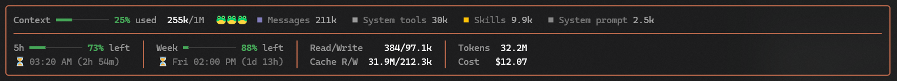

# cockpit

A bordered band right above the Claude Code prompt.



- **Branch**: the git branch the session works on (short sha when detached), refreshed after each Bash call and reply; hidden outside a repo.
- **Context**: how full the context window is, and the biggest categories filling it (as `/context` lists them, estimated locally).
- **5h / Week**: how much of each rate-limit window is left, when it resets (exact time and countdown, ticking each minute).
- **Read/Write, Cache R/W, Tokens**: tokens over the whole conversation, counted from the transcript at start and added to after each reply.
- **Cost**: the session's cost as `/cost` totals it.

Bars and percentages turn yellow from 70% used and red from 90%.

## Settings

| Setting | Default | |
| --- | --- | --- |
| `timezone` | `system` | IANA timezone for reset times, e.g. `Asia/Dhaka`. |
| `showBranch` | `true` | Show the branch row. |
| `showContext` | `true` | Show the context row. |
| `showLimits` | `true` | Show 5h / Week / On-demand. |
| `showTokenBreakdown` | `true` | Show Read/Write and Cache R/W. |
| `showTokens` | `true` | Show total tokens. |
| `showCost` | `true` | Show cost. |

Change them under `/config`. With every section off, the band is hidden.

## Develop

```sh
claude plugin validate mods/cockpit
claude plugin test mods/cockpit
```
